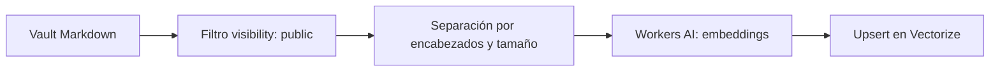
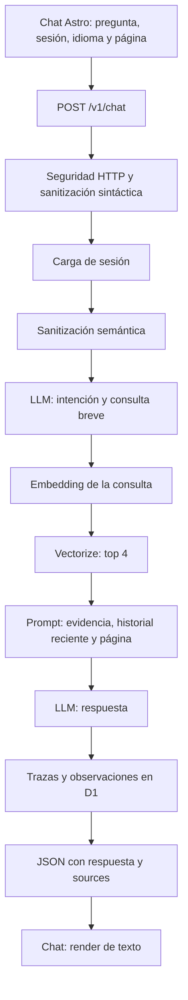

# Análisis del portfolio y del chatbot RAG

Fecha: 4 de octubre de 2026.

## Alcance y resultado

Se revisaron el frontend Astro, los casos de estudio, el flujo de aplicación Python, los adaptadores de Cloudflare, la ingestión del vault y las pruebas existentes. Se contrastó el código con el sitio publicado y con un build local.

El cambio aplicado es el texto de marca en el header de la homepage: **AI Engenier- Nacho Sanchez**, en español e inglés. Se conservó literalmente la escritura solicitada y se ajustó el nombre accesible del enlace. El resto de este documento describe cambios propuestos, todavía sin implementar. El cambio local no fue desplegado.

La base de arquitectura es útil: hay límites entre casos de uso y proveedores, una fuente Markdown compartida por páginas y RAG, sanitización previa a la recuperación, respuestas con metadata de fuentes y trazas para revisión. La siguiente mejora debería concentrarse en la calidad verificable de las respuestas y en mostrar evidencia de los proyectos.

## Verificación realizada

| Verificación | Resultado | Alcance |
| --- | --- | --- |
| `api/.venv/Scripts/python.exe -m pytest -m "not token" -q` | 67 pruebas aprobadas | Contratos y comportamiento offline; los adaptadores remotos usan dobles de prueba. |
| `npm.cmd run build` en `apps/web` | Build exitoso, 15 páginas | El primer intento falló con `spawn EPERM`; el segundo pasó con ejecución fuera del sandbox. |
| HTML generado para `/es/` y `/en/` | Header exacto presente | Comprobación adicional sobre los archivos generados. |
| Header en navegador a 1280, 768, 375 y 320 px | Sin superposición de marca y navegación | A 768 px existe un desborde del gráfico orbital del hero, independiente del header. |
| Ingestión actual, sin llamadas remotas | 16 documentos públicos y 85 chunks | No se regeneraron embeddings ni se modificó Vectorize. |
| Prueba de overflow del chunking | Pérdida de contenido reproducida | No se activa esta rama en el corpus actual. |
| Prueba de recuperación con score bajo | Un match con score `0.01` llega al contexto | Double de Vectorize: prueba la ausencia de filtro, no mide calidad real. |
| Consulta en el chatbot publicado | Error genérico en la interfaz | La apertura directa de `/health` fue bloqueada por el navegador con `ERR_BLOCKED_BY_CLIENT`. No permite concluir que la API esté caída. |

Capturas de la versión local: [escritorio](audits/2026-10-04/portfolio-header-desktop.png) y [móvil](audits/2026-10-04/portfolio-header-mobile.png).

## Flujo real del RAG

### Ingestión

La ruta de ingestión para producción está en `knowledge-base/scripts/upsert_vectorize.py`. Descarta el frontmatter, crea chunks de hasta 1800 caracteres y guarda `source`, `content`, `section` y `chunk_index`. Usa `@cf/baai/bge-base-en-v1.5`, igual que la consulta. El solapamiento de 240 caracteres solo se aplica como ventana deslizante al partir una línea demasiado larga; no es un solapamiento uniforme entre todos los chunks.

### Consulta

El Worker utiliza sesiones reconstruidas desde D1 cuando existe el binding `DB`; tiene fallback en memoria. La respuesta final recibe historial y contexto de página. La detección de intención y la recuperación, en cambio, reciben únicamente la consulta actual. Por turno normalmente hay tres llamadas a Workers AI: intención, embedding y generación; sin contexto se omite la generación.

El modo local utiliza `MemoryRetriever` con dos documentos escritos en código y modelos deterministas. No equivale a evaluar la recuperación desplegada contra los 16 documentos públicos.

## Hallazgos del chatbot y del RAG

### 1. Las fuentes se conservan, pero no se presentan

**Evidencia:** `chatService.ts` recibe `sources` y las guarda en `ChatMessage`. En `Chatbot.astro`, `render()` extrae solo `role` y `content`. El modelo devuelve todas las fuentes recuperadas; esto tampoco demuestra qué fuente respalda cada afirmación de la respuesta.

**Efecto:** el visitante no puede verificar fácilmente una respuesta ni continuar hacia el caso de estudio relacionado.

**Cambio propuesto:** mostrar fuentes únicas con nombres legibles y rutas válidas a proyectos/perfil. Separar “fuentes recuperadas” de citas efectivamente utilizadas. El mapeo debe resolver también `profile/now.md` y `profile/principles.md`, que no tienen una página de proyecto.

**Aceptación:** una respuesta respaldada muestra enlaces navegables sin duplicados. Una respuesta sin evidencia no muestra fuentes inventadas.

### 2. La recuperación pierde el referente de preguntas de seguimiento

**Evidencia:** `ChatFlowController` llama `DetectIntent.execute(message)` y después `RagQuery.execute(decision)`. El historial, el idioma y `page_context` se agregan posteriormente, al construir el prompt final.

**Efecto:** “¿Y qué mejorarías?” después de hablar de Eurosa, o “¿Qué problema resuelve?” dentro de su caso de estudio, pueden buscar evidencia de otro proyecto. Que el modelo final conozca la página no asegura que haya recibido los chunks correctos.

**Cambio propuesto:** construir una consulta autónoma usando la pregunta, una ventana breve del historial y el proyecto abierto. Conservar el mensaje original para responder. La página funciona como orientación de búsqueda, nunca como prueba de una afirmación.

**Aceptación:** las preguntas de seguimiento recuperan evidencia del proyecto pertinente y una pregunta nueva puede cambiar de tema.

### 3. La falta de evidencia se decide por cantidad, sin validar pertinencia

**Evidencia:** `CloudflareVectorizeRetriever` admite cualquier match con contenido y fuente. La prueba con un match de score `0.01` devolvió un chunk. `CloudflareLanguageModel` activa el fallback únicamente cuando `prompt.context` está vacío.

**Efecto:** un resultado cercano dentro del índice puede ser irrelevante para la pregunta y aun así habilitar una respuesta.

**Cambio propuesto:** calibrar un criterio de suficiencia con preguntas relevantes, ambiguas y fuera del dominio. No elegir un umbral universal sin medir la distribución de scores del corpus. Deduplicar resultados y conservar metadatos útiles de sección/proyecto para el prompt.

**Aceptación:** una consulta fuera del alcance produce una abstención útil; las consultas válidas siguen encontrando sus fuentes.

### 4. El chunking puede descartar parte de una línea

**Evidencia:** en `upsert_vectorize.py`, cuando `buffer + line` supera el máximo y la línea sola entra en el máximo, se hace `buffer = line[:overlap_chars].strip()`. Se conserva solo su comienzo.

Reproducción mínima: un documento con una línea de 70 caracteres `A`, seguida de otra de 40 caracteres `B`, con `max_chars=100` y `overlap_chars=10`, genera chunks de 70 y 10 caracteres. Se pierden 30 caracteres de la segunda línea. El escaneo de los documentos actuales encontró cero activaciones de esa rama con los parámetros de producción.

**Cambio propuesto:** conservar la nueva línea completa y aplicar el solapamiento, si se requiere, desde el fragmento anterior. Agregar una regresión que compruebe preservación del contenido al cruzar el límite con varias líneas.

**Aceptación:** ningún fragmento original desaparece por alcanzar el límite de tamaño.

### 5. El índice no retira vectores obsoletos

**Evidencia:** la ingestión hace upsert de IDs derivados de `source + chunk_index`, sin un manifiesto ni borrado de IDs retirados. El filtro de visibilidad actúa sobre los documentos que se vuelven a subir.

**Efecto:** si un documento se acorta, se elimina o deja de ser público, sus vectores anteriores pueden continuar en el índice. No se verificó que existan vectores obsoletos en el índice remoto.

**Cambio propuesto:** gestionar versiones/manifiesto de chunks y retirar los IDs que ya no pertenecen al corpus público. Para cambios de modelo, crear un índice versionado y validar antes de cambiar la consulta.

**Aceptación:** quitar una sección o retirar un documento del corpus lo elimina también de los resultados de recuperación.

### 6. La evaluación actual verifica estructura, no precisión

**Evidencia:** `questions.json` contiene seis preguntas. `test_knowledge_base_evaluation.py` comprueba campos, IDs y existencia de las fuentes; no ejecuta retrieval ni evalúa las respuestas. La respuesta esperada de `profile-003` enumera tecnologías de docencia que no están todas explícitas en `profile-es.md`.

**Cambio propuesto:** revisar primero las respuestas esperadas y ampliar un conjunto pequeño de consultas ES/EN, seguimientos, saludos, desconocimiento y límites de confidencialidad. Medir recuperación de fuentes y fidelidad de respuesta por separado, además de latencia y fallback.

**Aceptación:** un reporte reproducible identifica los casos que fallan, en lugar de declarar precisión porque existen los archivos referenciados.

### 7. El corpus bilingüe usa un embedding orientado a inglés

**Evidencia:** ingestión y consulta usan `bge-base-en-v1.5`. Su [model card de BAAI](https://huggingface.co/BAAI/bge-base-en-v1.5) lo clasifica como inglés. Cloudflare documenta [768 dimensiones y un máximo de 512 tokens de entrada](https://developers.cloudflare.com/workers-ai/models/bge-base-en-v1.5/).

**Interpretación:** es una elección a evaluar para ES/EN; no demuestra por sí sola que la recuperación en español sea incorrecta. El límite por caracteres tampoco garantiza respetar el límite por tokens.

**Cambio propuesto:** comparar el modelo actual con una alternativa multilingüe sobre las mismas consultas y comprobar el tamaño en tokens. Una migración requiere regenerar embeddings de documentos y consultas de forma compatible.

### 8. Errores, idioma y final de sesión necesitan estados explícitos

**Evidencia:** cualquier respuesta HTTP no exitosa produce el mismo error en `chatService.ts`. La UI busca la palabra inglesa `connect`, pero el error creado dice “conectar”; la mayoría de los fallos terminan en el mensaje genérico. El timeout es de 15 segundos. El backend limita la sesión a cinco preguntas, pero la UI no ofrece reiniciarla al llegar al límite.

El saludo del store está fijo en español y reemplaza al saludo localizado durante el render. El placeholder, “Talk” y “Try again” también están escritos directamente en inglés. La etiqueta del formulario usa `sr-only`, pero no se encontró una regla CSS para esa clase: permanece visible y consume espacio en el campo.

**Cambio propuesto:** errores tipados para validación, conexión, timeout, rate limit y fin de sesión; reinicio de conversación; saludo y controles localizados; corregir el estilo de la etiqueta accesible. Diferenciar reintento de un mensaje nuevo para evitar duplicar la pregunta en la UI.

**Aceptación:** interfaz coherente en ambos idiomas, campo de texto usable y recuperación clara después de un fallo o del sexto intento.

## Cambios propuestos para el portfolio

1. **Dar evidencia a los tres proyectos destacados.** Incorporar enlaces de demo/repositorio cuando existen, rol y estado real de desarrollo. El parser de proyectos no expone `evidence`, y los casos de estudio no muestran esos enlaces. El build de Eurosa no contiene un enlace a su demo pública.
2. **Corregir metadatos de los casos de estudio.** El parser regex no maneja el objeto YAML `period`; Eurosa termina mostrando `published · start: 2025-02`. Usar parsing estructurado y una fecha/estado orientados al lector. `published` es un estado editorial, no equivale a estar en producción.
3. **Hacer visible tu experiencia concreta.** La sección actual contiene dos párrafos generales. Agregar una cronología breve de desarrollo independiente, centro de innovación y docencia, con responsabilidades respaldadas por el perfil.
4. **Alinear el posicionamiento con AI Engineering.** El header solicitado comunica IA, mientras el hero sigue encabezado por “Full-Stack Software Engineer”. Ajustar esa introducción en una siguiente edición y conservar Full Stack como parte de tu capacidad para construir productos completos.
5. **Usar el espacio visual del hero para evidencia.** El gráfico orbital es decorativo; a 768 px su etiqueta `Production` alcanza aproximadamente 796 px y genera desborde. Una captura de producto o un diagrama compacto puede explicar mejor tu trabajo y resolver esa limitación responsive.
6. **Dar acceso al CV.** Incorporar un enlace a un archivo real cuando esté disponible y verificarlo como parte del recorrido de contratación.

## Orden recomendado

1. Fuentes visibles, estados de error/localización y consulta contextual.
2. Chunking sin pérdida, limpieza de vectores y criterio de evidencia suficiente.
3. Evaluación ES/EN para decidir embeddings y mejoras de recuperación con datos.
4. Casos de estudio con evidencia, experiencia concreta y refinamiento visual del hero.

Los hallazgos de código son comprobables localmente. Quedan pendientes la calidad del retrieval remoto, la fidelidad del modelo real y la latencia de producción, porque la prueba en navegador no pudo alcanzar la API. No se atribuye el bloqueo del cliente a una falla del servicio.
